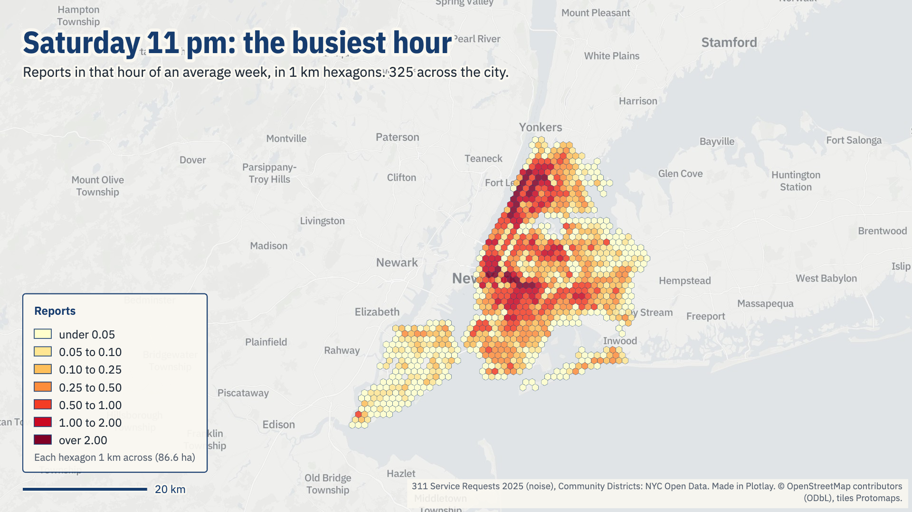
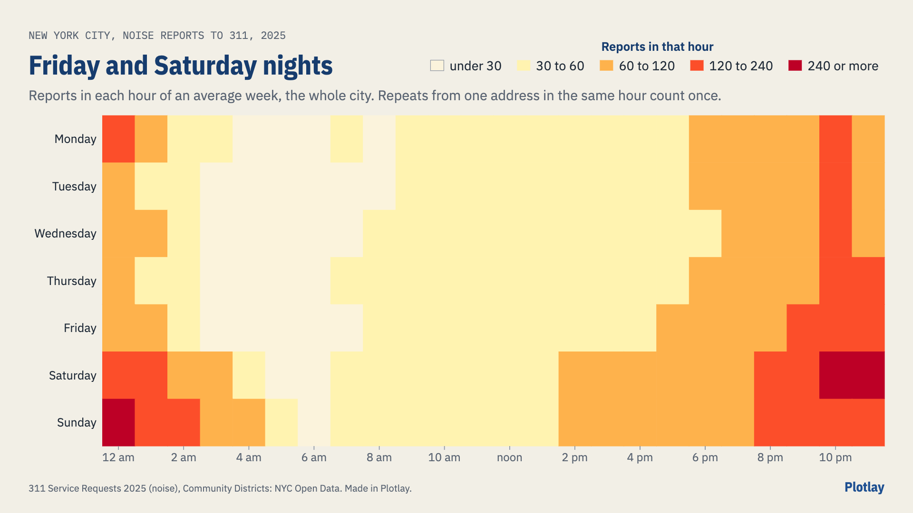

# When New Yorkers report noise, hour by hour

New York City's noise complaints to 311 in 2025, in 1 km hexagons, for each of the 168 hours of an average week: Monday 00:00 to Sunday 23:00. **Live version, with an interactive map and the week as a video:** [getplotlay.com/showcase/nyc-noise](https://www.getplotlay.com/showcase/nyc-noise/)



**In an average week of 2025, New Yorkers made 11,737 noise reports to 311. The busiest hour was Saturday 11 pm, with 325 reports across the city; the quietest, Tuesday 5 am, had 19: 17 times fewer.** 47.1% of reports came between 10 pm and 7 am, and Friday and Saturday nights alone (10 pm to 7 am) made up 22.1%.

**311 shows who reports noise, and when. It does not measure how loud the city is.** A street where people call often can be quieter than one where nobody calls.

[](https://app.plotlay.io/?example=nyc-noise&as=client)

## What the data says



- **The week has one shape.** Few reports in the morning, a slow climb through the afternoon, a peak late in the evening. Weekday nights reach about 120 reports in the 11 pm hour; Friday and Saturday nights two to three times that. Weekday middays average 36 an hour.
- **In 57 of 59 community districts** the busiest hour of the week is on Friday night, Saturday or early Sunday.
- **Each kind of noise keeps its own hours.** Construction, alarms and the other Department of Environmental Protection complaints peak on Saturday 8 am, helicopters on Sunday 5 pm, houses of worship on Sunday 10 am; homes, streets and bars late on Saturday.

| Complaint type | Requests 2025 | Reports after cleaning | In an average week | Busiest hour |
|---|---|---|---|---|
| Residential | 463,349 | 298,017 | 5,718 | Saturday 11 pm |
| Street or sidewalk | 173,049 | 150,312 | 2,885 | Saturday 10 pm |
| Commercial (bars, clubs, shops) | 63,958 | 54,957 | 1,055 | Saturday 11 pm |
| Construction, alarms and other (DEP) | 55,721 | 40,799 | 782 | Saturday 8 am |
| Vehicle | 43,223 | 38,808 | 745 | Friday 11 pm |
| Helicopter | 20,554 | 18,119 | 348 | Sunday 5 pm |
| Park | 10,081 | 8,558 | 164 | Saturday 10 pm |
| House of worship | 3,065 | 2,085 | 40 | Sunday 10 am |

All eight complaint types that start with "Noise" are included.

### Read it carefully

- **Who reports, not how loud.** 311 counts people who chose to report, through the app, online or by phone. How often people report depends on who lives and works somewhere, how they feel about calling, and whether they expect anything to happen. Read the map as reports, not as noise.
- **One address made 115,364 requests (13.9% of the year's 833,000).** All about residential noise, most of them minutes apart. Counted as raw requests it would be the brightest place in the city every hour. Here repeats from the same address about the same complaint type in the same clock hour count once, which keeps any one address to at most one report an hour for each type: 205,049 repeats in all, and that address's requests become 1,372 reports. The address is not named here.
- **Duplicates and positions.** 13,244 requests the Department of Environmental Protection itself closed as duplicates of an earlier complaint are left out, and so are 3,052 with no position. That leaves 611,655 reports.
- **Holidays and quiet days are kept.** Memorial Day, Labor Day and New Year's Day had about twice the reports of the same weekday around them, and the Fourth of July half as many again (fireworks complaints are a separate 311 type, not in here). The lowest days were a Friday and Saturday in April and some weekdays in May. Leaving the four oddest days out moves any one hour of the average week by at most 9.2% (Wed 02:00, because 1 January 2025 was a Wednesday), so they stay in: they happened.
- **An average week.** Each report counts as 1 over the number of times its hour of the week came round in 2025: 52 for most, 53 for Wednesdays (2025 started on a Wednesday), 51 for the Sunday 2 am that daylight saving skipped and 53 for the Sunday 1 am that came twice. Times are New York clock time, as 311 records them.
- **Positions are where the report says**, usually an address or an intersection, not where the noise was heard.

## How it was made with Plotlay

1. **A map project** on Plotlay's Quiet base map, and a **Data layer** of the city's community districts, from the Department of City Planning file: **Take all**, keyed by their own code.
2. **Link** each district's summary by key, and the year's reports **placed by position**, one row for each place and hour of the week, with the time column Mon 00:00 to Sun 23:00 in the week's order.
3. **Analyse, Count into a grid or hexagons**: 1 km hexagons, each holding the **total of the weights**, the reports in an average week, for every one of the 168 hours.
4. **Colour** the hexagons by the same breaks at every hour, and **Each point when zoomed in**: from zoom 14 the places themselves for the hour on the slider.
5. **Charts, map pictures and a board** on the Analysis page: the heat map of the week, the busiest and quietest hours, the share at night by district.
6. **Map video**: the map picture's frames, all 168 hours, on Plotlay's Quiet map by day and its Ink map with the Glow palette at night, changing at New York's average sunrise (06:29) and sunset (18:41) in 2025.

## What's here

| Folder | What |
|---|---|
| [`data/reports/`](data/reports) | `noise_reports_2025.csv.gz`: every report after cleaning, with its date, time, hour of the week, weight, type, borough, district and position |
| [`data/tables/`](data/tables) | `average_week.csv` (the city, each hour), `hexagons_by_hour.csv` (each hexagon, each hour), `community_districts.csv`, `types.csv`, `days.csv` (each day against its usual), `cleaning.json` |
| [`data/geometry/`](data/geometry) | The hexagons and the community districts: GeoJSON and TopoJSON |
| [`python/`](python) | A narrated notebook that recomputes every number here from the reports: [`noise_week.ipynb`](python/noise_week.ipynb) |
| [`powerbi/`](powerbi) | A Power BI Project (`.pbip`). Start with [`powerbi/OPEN-ME.md`](powerbi/OPEN-ME.md) |
| [`visuals/`](visuals) | The map pictures and charts, made in Plotlay |

### Run the notebook

```
python3 -m venv .venv
.venv/bin/pip install -r python/requirements.txt
cd python && ../.venv/bin/jupyter lab noise_week.ipynb
```

## Sources and licences

- **Code** (notebook, Power BI project): MIT, see [`LICENSE`](LICENSE).
- **Our data** (the tables and shapes): CC BY 4.0, see [`LICENSE-DATA`](LICENSE-DATA). Credit "Plotlay (getplotlay.com)" and NYC Open Data.
- 311 Service Requests from 2010 to Present (dataset erm2-nwe9) and Community Districts (5crt-au7u), NYC Open Data, downloaded 14 November 2026. NYC Open Data is published with no restrictions on use (NYC Admin Code 23-502); the wording and the changes made are in [`NOTICE`](NOTICE).
- Base maps in the pictures and the video: Plotlay's Quiet and Ink maps, from OpenStreetMap data (ODbL). No OpenStreetMap data is in `data/`.

This is independent work using open data, not endorsed by the City of New York.
